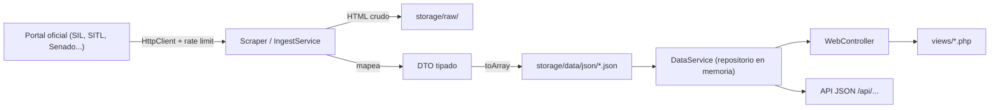

# Arquitectura de Pulso Cívico

## Principios
1. **Low-cost**: sin frameworks, sin Composer, sin base de datos. Corre en cualquier hosting PHP barato.
2. **Datos trazables**: todo registro conserva su fuente oficial.
3. **Capas separadas**: las vistas nunca leen archivos ni llaman a portales externos directamente.

## Flujo de datos



## Estructura de carpetas
```
index.php            Front controller web (único punto de entrada)
config/config.php    Configuración (lee .env)
src/
  Core/              Router, HttpClient, Logger, ViewHelper
  Controllers/       WebController (rutas → vistas)
  DTO/               LegisladorDTO, VotacionDTO, SesionPlenoDTO (contratos de datos)
  Services/          DataService (lectura), SilIngestService y ParliamentScraperService (ingesta), EducationService (análisis)
views/               Plantillas (layout/, partials/, páginas)
storage/
  data/json/         Datasets finales publicados
  raw/photos/        Fotos oficiales (únicas accesibles por HTTP dentro de storage)
  raw/html/          Descargas crudas (no versionadas)
  logs/              Bitácoras (no versionadas)
tools/
  gateway.php        CLI universal: php tools/gateway.php <accion>
  run.ps1            Atajo Windows hacia gateway.php
  core/              Linter, GitOps, Inspector, ScraperRouter
bin/console.php      CLI de ingesta
database/schema.sql  Modelo relacional de referencia (futuro, no usado en runtime)
```

## Rutas web
| Ruta | Descripción |
|---|---|
| `/` | Inicio + mapa |
| `/politicos/{slug}` | Perfil de legislador |
| `/estados/{slug}` | Legisladores por entidad |
| `/comisiones`, `/comisiones/{slug}` | Comisiones |
| `/estudios`, `/estudios/{categoria}` | Estadísticas |
| `/api/buscar`, `/api/estados/{slug}` | API JSON |
| `/sitemap.xml` | SEO |

## Seguridad
- `.htaccess` bloquea `src/`, `tools/`, `config/`, `storage/` (salvo fotos), dotfiles y logs.
- Toda salida en vistas se escapa con `ViewHelper::e()`.
- Configuración sensible solo en `.env` (nunca versionado).

## Deuda técnica conocida (buenas tareas para voluntarios)
- Archivos grandes por dividir: `SilIngestService.php`, `DataService.php`, `EducationService.php`, `views/politico.php`.
- Autoloader PSR-4 duplicado en varios archivos → centralizar en `src/bootstrap.php`.
- Falta `ScraperInterface` común para nuevas fuentes.
- Sin tests automatizados ni CI.
- `index.old.php` y `app.php` son legacy; `views/layout/header.php` referencia `assets/og-cover.png` inexistente.
