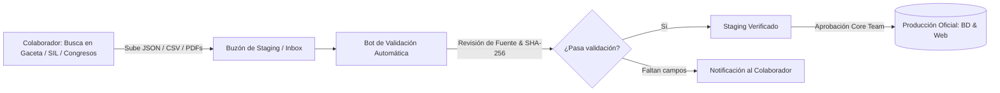

# 📥 Pipeline de Datos por Staging (Colaboración sin Git)

> **Para colaboradores no técnicos, periodistas, investigadores o devs que no quieran clonar el repositorio completo.**

No necesitas saber Git ni instalar PHP para aportar información oficial. Hemos diseñado un flujo donde cualquiera puede extraer datos y enviarlos a un **Buzón de Staging**, donde el sistema los procesa, valida y pasa a producción de forma segura.

---

## 1. El Flujo de Ingesta por Staging



---

## 2. Formas de Enviar Datos al Staging

### Opción A: Plantilla de Google Sheets / Formularios (Fácil para periodistas)
1. El colaborador llena una hoja de cálculo estándar con las columnas:
   * `nombre_completo`
   * `cargo` (Diputado / Senador)
   * `partido`
   * `estado`
   * `fuente_oficial_url` (Link directo a la Gaceta o portal)
   * `enlace_documento` (PDF o captura)
2. El equipo exporta a CSV o la API del sistema descarga periódicamente el Sheet hacia `storage/staging/inbox/`.

### Opción B: Subida Directa de Archivos JSON/CSV (Para devs y analistas de datos)
* Los archivos se depositan en una carpeta designada o mediante un Issue en GitHub con la etiqueta `datos:staging`.
* Formato esperado: archivo estructurado según [DATA_SCHEMA.md](DATA_SCHEMA.md).

---

## 3. ¿Cómo funciona la Validación Técnica en Staging?

El sistema cuenta con un comando interno que procesa los archivos en cola:

```bash
# Procesa y valida archivos depositados en el staging
php tools/gateway.php staging:validate "storage/staging/inbox/datos_jalisco.json"
```

El script verifica automáticamente:
1. **Verificación de URL**: Que la `fuente_url` exista y responda con HTTP 200.
2. **Generación de Evidencia Criptográfica**: Calcula el `sha256` del documento.
3. **Respaldo en Wayback Machine**: Manda a archivar la página oficial.
4. **Prueba de Esquema**: Que no falten nombres ni identificadores clave.

Una vez que el archivo pasa todas las pruebas con éxito, se genera un reporte limpio para que el Core Team lo incorpore a la base de datos oficial con un solo clic.
